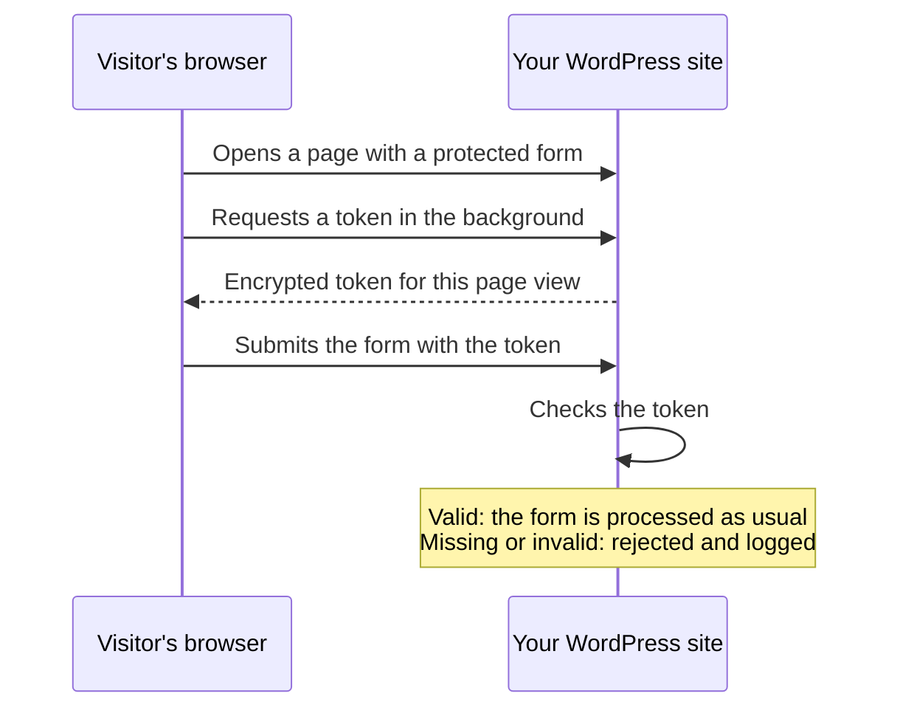

# WPBruiser: No-CAPTCHA Anti-Spam & Login Protection

Stop spam on contact forms, comments, logins and registrations with an invisible check. No CAPTCHA, no puzzles, no third-party service.

[](https://wordpress.org/plugins/goodbye-captcha/)
[](https://wordpress.org/plugins/goodbye-captcha/#reviews)
[](https://wordpress.org/plugins/goodbye-captcha/)
[](https://wordpress.org/plugins/goodbye-captcha/)
[](https://wordpress.org/plugins/goodbye-captcha/)
[](https://www.gnu.org/licenses/gpl-2.0.html)

[](https://wordpress.org/plugins/goodbye-captcha/)

[Download on WordPress.org](https://wordpress.org/plugins/goodbye-captcha/) &nbsp;·&nbsp; [Documentation](https://www.wpzoom.com/documentation/wpbruiser/) &nbsp;·&nbsp; [WPBruiser Pro](https://www.wpzoom.com/plugins/wpbruiser/) &nbsp;·&nbsp; [Support Forum](https://wordpress.org/support/plugin/goodbye-captcha/)

## How it works

Every protected form gets a hidden token, which the visitor's browser requests in the background. A real person never sees it or has to do anything. A bot that posts straight to your login, registration or comment endpoint arrives without a valid token and is turned away before WordPress processes the submission.



Because bad submissions are rejected at the door, they never land in your moderation queue and never create junk user accounts. Everything runs on your own server: no remote APIs, no outside scripts or fonts, and no visitor data sent anywhere.

## Features

### Spam protection
- **WordPress forms**: login, registration, lost password and comments, with optional character limits for the comment fields
- **Free integrations**: [WPZOOM Forms](https://wordpress.org/plugins/wpzoom-forms/), Ultimate Member, WP-Members, Login With Ajax, Jetpack contact form, MC4WP: Mailchimp for WordPress, HTML Forms and wpDiscuz
- **One-click setup**: the Integrations screen shows which supported plugins are active and switches each on with one click; a new install protects everything it finds
- **Works with page caching**: the token is requested fresh on every page view, so no pages need excluding

### Login protection
- **Login lockouts**: an IP address is locked out after too many failed logins, and for longer when it keeps coming back. Covers the login form, XML-RPC, application passwords and other plugins' login forms
- **Banned usernames**: an IP that tries "admin", "root" and similar names nobody on your site uses is locked out at once
- **Lockdown mode** (optional): during a detected attack, only IP addresses each user logged in from before can log in
- **Custom login URL** (optional): move the login page to an address only you know; `wp-login.php` and `wp-admin` show a "not found" page to visitors
- **Brute-force detection**: spots an attack in progress, emails you, and can block the IPs behind it
- Optional lists of known web attackers and anonymous proxies, including Tor exit nodes

### Hardening
- Stop user enumeration through `/?author=N`, oEmbed and the REST API
- Restrict the REST API to logged-in users, with an allow list for plugins that need it
- Turn off XML-RPC or just its pingbacks, turn off application passwords, and block PHP in the uploads folder
- Hide the WordPress version and the RSD and Windows Live Writer links

### Reports & tools
- Blocked attempts per day and per form, a world map, and the content bots tried to send
- A Dashboard widget with the last day, week and month
- IP allow and block lists (IPv4 and IPv6, ranges and CIDR)
- Email notifications for attacks and administrator logins
- Test Mode, to check protection before switching it on for real

## WPBruiser Pro

[WPBruiser Pro](https://www.wpzoom.com/plugins/wpbruiser/) is an add-on that brings the same invisible check to more plugins and adds a few security extras:

- **Form builders**: Contact Form 7, WPForms, Elementor Pro, Gravity Forms, Fluent Forms, Forminator, Ninja Forms and Formidable Forms
- **eCommerce**: WooCommerce (login, registration, reviews and checkout, including the Checkout block) and Easy Digital Downloads, with card-testing protection
- **Newsletters**: MailPoet
- **Country blocking** and **submission rate limits**
- Priority support from the WPZOOM team

## Installation

### From WordPress.org

1. Go to **Plugins > Add New** in your WordPress admin
2. Search for **WPBruiser**
3. Click **Install Now**, then **Activate**

### Manual installation

1. Download the plugin from [WordPress.org](https://wordpress.org/plugins/goodbye-captcha/)
2. Upload it to `/wp-content/plugins/goodbye-captcha/`
3. Activate it on the **Plugins** screen

### From GitHub

```bash
cd wp-content/plugins
git clone https://github.com/wpzoom/goodbye-captcha.git
```

The folder must be named `goodbye-captcha`, the plugin's slug on WordPress.org. There's no build step.

## Getting started

1. Open **WPBruiser > Integrations** and check that the forms you use are switched on
2. Review the login protection on **WPBruiser > Security**
3. Watch blocked attempts arrive on **WPBruiser > Reports**

The [getting started guide](https://www.wpzoom.com/documentation/wpbruiser/getting-started-with-wpbruiser/) walks through every screen.

## For developers

WPBruiser has a small extension API for protecting forms it doesn't cover yet. Add the token field to your form, then check the submission in your form's own validation:

```php
// Print the hidden token field inside the form.
add_action( 'my_form_fields', function () {
	echo wpbruiser_get_token_field_html(); // already escaped
} );

// Reject the submission when the token check fails.
add_filter( 'my_form_is_spam', function ( $is_spam, $fields ) {
	return wpbruiser_verify_submission( 'MyModule', 'IsMyFormActivated', $fields ) ? $is_spam : true;
}, 10, 2 );
```

Modules are registered through the `wpbruiser_register_modules` filter, which is how WPBruiser Pro adds its integrations. Other hooks include `wpbruiser_loaded`, `wpbruiser_reject_reason` and `wpbruiser_country_id_for_ip`. See the [developer reference](https://www.wpzoom.com/documentation/wpbruiser/developer-hooks/) and [`engine/wpbruiser-extension-api.php`](engine/wpbruiser-extension-api.php).

## Requirements

- WordPress 6.5 or higher
- PHP 7.4 or higher
- JavaScript in the visitor's browser (for the token)

## Security

Please report security bugs through the [Patchstack Vulnerability Disclosure Program](https://patchstack.com/database/vdp/9e5fbdc6-fec3-4600-a6c2-5dc832c2bce4). The Patchstack team helps with verification and CVE assignment, and notifies us.

## Contributing

Contributions are welcome. Please open a pull request against `main`:

1. Fork the repository
2. Create a feature branch (`git checkout -b feature/my-change`)
3. Commit your changes
4. Push the branch and open a pull request

Releases are deployed to WordPress.org from this repository with GitHub Actions.

## Bugs

Found a bug? [Open an issue](https://github.com/wpzoom/goodbye-captcha/issues).

## Support

This repository is for development and is _not_ a support channel. For help, please use the [support forum](https://wordpress.org/support/plugin/goodbye-captcha/) on WordPress.org, or the [documentation](https://www.wpzoom.com/documentation/wpbruiser/).

## Credits

WPBruiser was created by [Mihai Chelaru](https://profiles.wordpress.org/mihche/). Since version 3.2.0 it's maintained by [WPZOOM](https://www.wpzoom.com/).

## License

WPBruiser is licensed under the [GPL v2 or later](https://www.gnu.org/licenses/gpl-2.0.html).

---

**Links:** [WordPress.org](https://wordpress.org/plugins/goodbye-captcha/) | [WPBruiser Pro](https://www.wpzoom.com/plugins/wpbruiser/) | [Documentation](https://www.wpzoom.com/documentation/wpbruiser/) | [WPZOOM](https://www.wpzoom.com/)
